  <a href="https://github.com/swastikparmar987?tab=repositories">Repositories</a>
  &nbsp;&nbsp;·&nbsp;&nbsp;
  <a href="https://www.linkedin.com/in/swastik-parmar-72010b34a/">LinkedIn</a>

## Practical AI, carefully engineered

I build useful systems at the intersection of **computer vision**, **deep learning**, and **AI reliability**. My work moves from an experiment to an interface: establish a baseline, inspect failure cases, and make the result usable.

## Selected work

<table>
<tr>
<td width="50%" valign="top">

### [SignBridge](https://github.com/swastikparmar987/signbridge)

An interactive sign-language communication assistant that recognizes hand movement from video and live camera input.

`MediaPipe` &nbsp; `PyTorch` &nbsp; `GRU` &nbsp; `FastAPI`

 
<a href="https://github.com/swastikparmar987/signbridge">Explore the implementation ↗</a>

</td>
<td width="50%" valign="top">

### [HalluciGuard](https://github.com/swastikparmar987/HalluciGuard--A-LLM-Hallucination-firewall)

An LLM response firewall that scores hallucination risk across four signals and separates responses into safe, caution, and blocked zones.

`Python` &nbsp; `React` &nbsp; `FastAPI` &nbsp; `Ollama`

 
<a href="https://github.com/swastikparmar987/HalluciGuard--A-LLM-Hallucination-firewall">Explore the implementation ↗</a>

</td>
</tr>
<tr>
<td width="50%" valign="top">

### [Vision Attend](https://github.com/swastikparmar987/ai_cctv_attendance_system)

A computer-vision attendance prototype combining person detection, face embeddings, tracking, temporal evidence, and a real-time dashboard.

`Python` &nbsp; `OpenCV` &nbsp; `FastAPI` &nbsp; `React`

 
<a href="https://github.com/swastikparmar987/ai_cctv_attendance_system">Explore the implementation ↗</a>

</td>
<td width="50%" valign="top">

### [Ultimate Toolbox](https://github.com/swastikparmar987/ultimate-toolbox-releases)

An offline-capable desktop utility suite for media, developer, design, and system workflows, with releases for Windows, macOS, and Linux.

`Desktop app` &nbsp; `JavaScript` &nbsp; `Cross-platform`

 
<a href="https://github.com/swastikparmar987/ultimate-toolbox-releases/releases">View the releases ↗</a>

</td>
</tr>
</table>

## Working toolkit

| Area | Technologies I use in public projects |
| --- | --- |
| **AI / vision** | Python · PyTorch · MediaPipe · OpenCV · computer vision |
| **Models / reliability** | GRU sequence models · embeddings · LLM evaluation · Ollama |
| **Product engineering** | FastAPI · React · TypeScript · JavaScript · SQLite |
| **Delivery** | Docker · GitHub · local-first workflows |

This is a map of the repositories above, not a claim of equal depth across every tool.

## GitHub, in motion

Live repository and language visuals are provided by the community-maintained readme-stats service; they are supplementary and may be unavailable.

## Currently exploring

- Making AI outputs easier to evaluate, explain, and trust.
- Building computer-vision systems that survive the move beyond a notebook.
- Connecting temporal models and inference pipelines to practical product experiences.

Build a baseline. Find the failure. Improve the system.

