

<a href="https://github.com/swastikparmar987">
  
</a>

 

 



 


  <a href="https://github.com/swastikparmar987/HalluciGuard--A-LLM-Hallucination-firewall"></a>
  <a href="https://github.com/swastikparmar987/ai_cctv_attendance_system"></a>
  <a href="https://github.com/swastikparmar987/signbridge"></a>
  <a href="https://github.com/swastikparmar987/ultimate-toolbox-releases/releases"></a>
  <a href="https://github.com/swastikparmar987?tab=repositories&q=studysync"></a>
  <a href="https://github.com/swastikparmar987?tab=repositories&q=orbis"></a>

 


  
   
  
   
  

 



 


    username=swastikparmar987&show_icons=true&include_all_commits=true&rank_icon=github&bg_color=3F72E5&title_color=FFC93C&text_color=FFFFFF&icon_color=FFFFFF&ring_color=FFC93C&border_color=11162B&border_radius=22" alt="GitHub stats" height="180">
  

  <picture>
    <source media="(prefers-color-scheme: dark)" srcset="https://raw.githubusercontent.com/swastikparmar987/swastikparmar987/output/snake-dark.svg">
    
  </picture>

 

  <b>Looking for a party?</b> I team up on computer vision, LLM evaluation and AI products that have to survive outside a notebook.
    
  <a href="https://www.linkedin.com/in/swastik-parmar-72010b34a/">LinkedIn</a>
  &nbsp;·&nbsp;
  <a href="mailto:swastikparmar987@gmail.com">swastikparmar987@gmail.com</a>
  &nbsp;·&nbsp;
  <a href="https://github.com/swastikparmar987?tab=repositories">All repositories</a>

